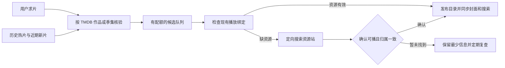

# 按需求建立可播放目录

旧 TMDB 全量库存和 IMDb 全量文件同步在空库切换时暂停。新目录每天从有明确观看需求的作品建立候选，使用可播放资源作为发布条件。本文记录拟实施的选片和保留规则，以及本轮空库切换的边界。

## 每日选片和资源补抓

| 输入 | 每日读取范围和用途 |
| --- | --- |
| TMDB | 电影、剧集和纪录片的规范身份。用热榜、长期高关注作品、近期发行或播出变化建立候选。 |
| IMDb | 公开热门和经典榜提供长期需求信号及身份线索。按已入选作品补 IMDb 资料。 |
| 豆瓣 | 直接通过现有代理读取原站榜单和已入选条目，补中文标题、别名、评价与中国大陆发行信息。 |
| 烂番茄 | 用近期流媒体热门和口碑列表补候选。影评人与观众评分保留来源标签。 |

每个来源每天一个同步批次，保留独立检查点。某来源失败只延迟该来源。多榜单命中增加优先级，评分样本量与发行时间分开判断。TMDB 维持目录身份，候选通过类型和经核验的外部 ID 去重，剧集以季、集明确补抓范围。现有代理池和来源限流适用于所有外部请求。

首批预算按 800 部历史热片和每日最多 60 个新候选设计。新电影优先近 45 天可播发行，剧集增量看最近 14 天实际播出的季集。未发布候选最多 2,000 项，建议使用 14 天有效期，只保留作品 ID、命中来源、缺失范围、复查状态和最少核验资料。公开目录先控制在 3,000 部以内，根据可播命中率、真实观看和容量再调整。用户求片单独进入高优先级预算。缺少可靠权威目录的短剧和体育继续通过来源优先的入口进入同一播放校验流程。

播放来源须通过身份、季集和可用性核验。已找到可播范围时才注册正式封面、写入公开投影并更新 ES。等待来源期间保留复查状态。失效来源按错误退避，超过期限且没有观看请求的候选释放配额。已有播放或用户引用的作品保留可访问路径。前台热播和最新更新从已发布作品生成，最新更新取新发行、新集播出或可播放线路真正上线的时间。

容量以候选与公开目录配额、封面卷剩余空间和 Longhorn 实占共同控制。清理前每个 R2 对象平均约 81 KiB。按每部作品一张主封面估算，3,000 部约需 237 MiB。封面继续内容去重，R2 存储确认后按字节配额回收本地副本。每天的成功、上游失败、无资源、身份冲突及重试结果分别记录。

[TMDB Discover](https://developer.themoviedb.org/reference/discover-movie) · [TMDB Trending](https://developer.themoviedb.org/reference/trending-all) · [豆瓣经典榜](https://movie.douban.com/top250) · [烂番茄流媒体热门](https://www.rottentomatoes.com/browse/movies_at_home/sort:popular)

## 本次空库切换

暂停全量库存、IMDb 文件、豆瓣补充、旧榜单和旧补抓调度。沿用已验收的 GitOps 停写方式。确认应用、队列消费者和业务库连接退出后，清除当前 IRCS 库的内容、来源、历史任务、投影和水位。保留数据库结构、配置、凭据、源站和字典。保留原有定时计划定义，将状态复位并保持停用。

同步清除当前 IRCS 的 ES 应用索引、R2 封面及本地副本、过期工作消息和专用缓存。按实际引用验证操作范围。复查数据库、对象及索引的空状态后恢复应用，旧全量同步仍暂停。恢复应用所用的上一版配置可以从 GitOps 追溯，旧业务内容可由后续采集重建。

[上次空库切换记录](142-v3-empty-catalog-reset.md) · [当前实体关系](../reports/143-v5-catalog-model-rebuild.md)

## 2026-11-25 执行记录

- 在 25 个应用 Deployment 停写、专用 RabbitMQ vhost 的消费者和积压均为 0、业务库其他连接为 0 时执行清理。删除 1,201 个目录条目、391 条来源记录与 3,032,745 条库存行。清理后业务库约 16 MiB，保留 25 个来源配置、25 个停用定时定义和 12 项集成凭据。
- Elasticsearch 按名称移除 5 个 IRCS 应用索引，复查为空。删除并复核 R2 `ircs` 桶中的 1,399 个当前目录对象，合计 115,629,677 字节。本地当前封面及头像前缀复查文件数为 0。清理 IRCS 专用 Valkey 的运行缓存和旧任务数据。
- GitOps 恢复应用副本，保持旧权威库存、参考源、补抓、求片派发和榜单调度暂停。按需求选片的流程仍属于设计范围。 [暂停提交](https://github.com/Prodigalgal/k8s-gitops-config/commit/024cfb867957694eb7a4a4fa5d7737016de217bf) · [恢复提交](https://github.com/Prodigalgal/k8s-gitops-config/commit/772e6aff984697fab98b1bef5d9dada7a31a5291)
- 恢复后两个生产 Argo CD 应用均为 `Synced / Healthy`，26 个 Deployment 全部就绪。公网首页及首页接口均返回 HTTP 200，影片区均为空。两张 ES 内容索引均为 0 文档，审计索引已开始记录恢复后的操作。
- 核对旧库没有工作负载引用或数据库连接后，删除退役库 `ircs_catalog_v3_clean_20261123`。删除 11 月 12 日切换留下的 7 份本地配置备份。Longhorn 当前无远程备份，活动 ES 无快照仓库。
- 旧封面卷的最后一个可恢复快照已标记移除，上一层已通过 Longhorn 合并。旧卷重新分离，IRCS 的 8 个卷复查可恢复快照为 0。使用 Longhorn `Trim Filesystem` 回收 PostgreSQL 的空闲块，卷实占从 9.45 GiB 降到 1.66 GiB。Longhorn V1 的已移除快照可继续作为卷头的父层等待后续合并。 [Longhorn 快照与删除](https://longhorn.io/docs/1.12.0/snapshots-and-backups/setup-a-snapshot/) · [Longhorn 文件系统回收](https://longhorn.io/docs/1.12.0/nodes-and-volumes/volumes/trim-filesystem/)
- 11 月 8 日运维归档记录过两份旧克隆备份。原克隆路径已经不存在，在工作区、现有 GitOps 和集群备份目标中未定位到这两份文件，去向待确认。
