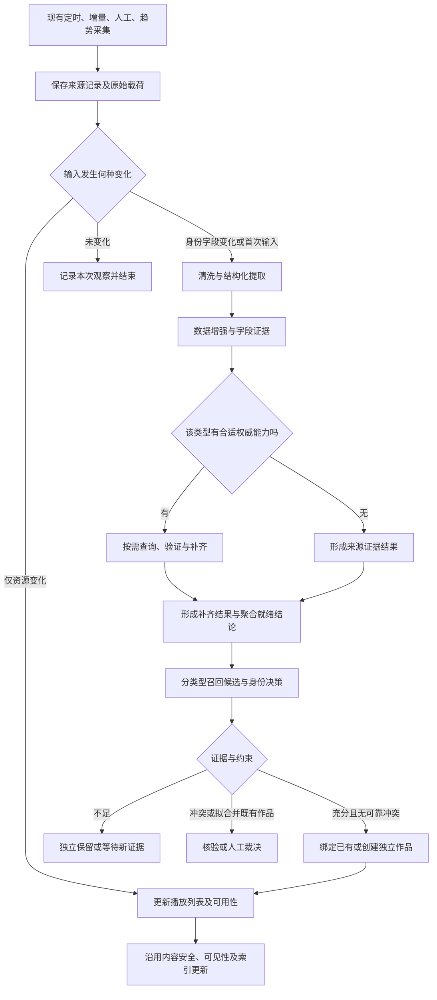

# 采集后数据质量与聚合增强设计

日期：2026-11-14

状态：首轮 3.4.11 已部署并验收；本文区分本轮落地、运行证据与后续设计。其他任务保持暂停。

适用：现有 V3 采集、规范化、元数据补齐、聚合链路。

## 1. 最终范围与架构决定

按用户最后确认的方向，保留现有源站采集流程，增强采集后的数据处理：

**源站采集 → 原始数据入库 → 数据清洗 → 数据增强 → 按需权威补齐 → 身份决策与聚合 → 资源更新及现有发布流程。**

源站分页、增量窗口、定时任务、人工采集、趋势补源继续作为输入。现有任务、来源、raw、unified 与用户数据的稳定 ID 保留。复用当前服务和仓库，不另建采集项目、主目录系统或微服务。

本设计优先解决三个问题：

1. 数据进入聚合前，清楚表达“原文是什么、提取了什么、为什么这样改”。
2. 权威数据作为可核验的补充证据；目录缺失、类型不支持和真实调用故障分别处理。
3. 聚合根据完整身份和证据作决策，并能解释、局部纠错和恢复任务。

全量同步 TMDB/IMDb 不作为本轮前置工作。将来确有目录浏览、冷门片补源等需求时，可增加目录同步入口，仍进入本流水线。

### 1.1 方案比较

| 方案 | 收益 | 主要成本或缺口 | 本次决定 |
| --- | --- | --- | --- |
| 仅继续调整聚合阈值 | 实施快 | 上游身份信息不完整、字段被误解和状态交接问题仍会传入聚合 | 阈值调整需有评测依据 |
| 所有内容先入权威目录再采集 | 电影剧集有较好身份锚点 | 短剧、体育、小众及未收录内容覆盖不足；全量详情和全源补源请求量大 | 不作为通用主干 |
| 保留采集，增强清洗、取证、补齐和聚合 | 保留覆盖面，复用现有运行能力，按内容类型改善质量 | 需要统一字段语义、证据版本和完成契约 | 采用 |

“保留原流程”保留入口与业务能力。已确认的错误字段处理、任务交接缺陷和不安全合并规则仍需改进。

## 2. 当前证据与判断边界

### 2.1 代码事实

| 现有位置 | 已确认事实 | 对设计的影响 |
| --- | --- | --- |
| `services/ircs-scraper-service/.../ListScraperClient.java` | 支持列表、详情、关键词参数、网络策略和代理配置 | 复用适配器；不能据通用 `wd` 参数就认定每个源站都正确支持搜索 |
| `services/ircs-scraper-service/.../ScraperMappingService.java` | 保存规范字段，并保留 `sourcePayload` | 优先利用现有原始证据，先核实提取与传递，避免无依据重抓 |
| `services/ircs-normalization-worker/.../RawVideoTextNormalizer.java` | 已有繁简/字形转换、标题清理、季与副标题提取、锁定字段 | 在现有实现上拆清语义；展示值和比较键需要区别 |
| `services/ircs-content-service/.../TrendSyncContentService.java` | 趋势条目可创建 unified，并输出补源标题关键词 | 保留趋势功能；补源上下文应携带目标身份，关键词不能独自代表目标 |
| `services/ircs-task-service/.../TrendDiscoveryTaskService.java` | 按关键词与来源安排任务，已有数量限制和任务复用 | 复用调度；补充目标上下文、查询去重与覆盖记录 |
| `shared/ircs-common/.../SystemConfigCache.java` | 现有约定为 L1 本地、L2 Valkey、L3 数据库加载 | 延续分层缓存，L3 是实际回源负载，需要限制与计量 |
| `shared/ircs-common/.../DistributedRuntimeWorkQueue.java` | 已有租约、CAS、延期、过期恢复与 DLQ 机制 | 复用执行能力，把完成事实、依赖等待与失败原因衔接清楚 |

上述路径均相对于 `backend/`。既有聚合约束与数据保护依据包括报告 138、139、140。本设计不覆盖改写用户的报告 138。

### 2.2 生产只读基线

2026-11-14 22:03 左右（北京时间）的快照：

| 项目 | 数值 |
| --- | ---: |
| 数据源配置 | 25 |
| 有 raw 数据的数据源 | 24 |
| raw | 51,857 |
| normalization PENDING / FAILED | 0 / 0 |
| enrichment PENDING | 83 |
| aggregation BOUND / PENDING | 51,554 / 303 |
| unified | 18,160 |
| 绑定关系 / 悬空绑定 | 51,713 / 0 |

25 个来源均有列表、详情路径配置；这些配置的存在不能证明每个来源当前可达、搜索语义正确或资源可播放。本轮未对源站发起新的可用性测试。

既有排查发现 83 条补齐等待中，71 条已有结束的持久 provider run，12 条仍有待完成 run、对应执行任务在 DLQ。说明完成事实与状态投影、任务交接存在脱节；这与内容是否能被识别是两个问题。

### 2.3 清洗观察与尚未证明的质量

按固定种子 `20261114-pipeline-redesign` 对 18 条 READY 输入只读观察：

- 体育记录的参赛双方位于 `subtitle`，主标题保留日期、赛季和联赛。
- 部分短剧按逗号或冒号拆成主标题与副标题。
- 部分数字被提取为季；个别字形和双语标题发生变化。

副标题存在，因此不能把主标题缩短直接判为信息丢失。需要检验搜索、补齐、相似度计算和最终身份约束是否始终使用完整信息。数字是否真是季、专名转换是否正确，仍需标注和逐条取证。

当前字段已可能经过清洗与补齐，原文和当前值的差异不能全部归因于某一个清洗函数。18 条样本不是准确率评测。此前 100 条身份检查覆盖 99 个不同 unified，也只是规则兼容性观察，不能充当人工真值。

## 3. 核心对象与处理契约

复用现有业务对象，增加必要的结果和证据表达：

| 对象 | 职责 | 关键约束 |
| --- | --- | --- |
| 原始来源记录 | `dataSourceId + sourceVid`、来源字段、抓取时间、原始载荷 | 来源 ID 只证明来源内记录，不证明跨源同作品 |
| 清洗结果 | 展示候选、完整标题、比较键、结构化片段、清洗动作 | 保留原文、字段路径、规则版本和告警 |
| 增强证据 | 季/集/编号/赛事信息、演员导演、别名、类别、来源声明 ID | 区分提取结果、推断值与核验值 |
| 补齐结果 | 候选权威对象、实体粒度、匹配依据、补充字段、执行结论 | 查到一个 ID 不等于证明该资源属于该 ID |
| 聚合决策 | 输入版本、候选、目标、规则、拒绝或绑定原因 | 普通资源绑定与合并既有 unified 分开 |
| 来源资源 | 播放列表、集序、清晰度、语言、有效性、最近检查时间 | 资源更新不等于作品身份变化 |

`unified_videos` 继续承载公开业务 ID、收藏和历史引用。证据存储不能形成另一套平行内容主表。

### 3.1 输入版本

现有 `data_hash` 继续表达其既有契约。增加或明确三个维度：

1. 身份输入指纹：完整标题、可靠年份、类别、季、版本、编号、身份相关关系和来源声明 ID。
2. 资源指纹：播放列表、集序、资源地址、清晰度和语言等。
3. 处理版本：清洗规则、提取器、补齐结果、身份映射、人工修订和聚合规则版本。

最终决策指纹须覆盖实际使用的证据版本。播放地址变化主要刷新资源；新的可靠 ID、季或身份字段变化才触发重识别。不能只检查原始 hash 未变就使用旧聚合结论。

带签名地址的易变参数按具体适配器处理；不能全局删除 URL 查询串来计算资源指纹。

## 4. 处理总流程

主流程中的每个完成点都指当前输入版本；上个版本成功不能掩盖新版本未处理。身份状态、资源有效性、内容安全、索引同步分别可见。

## 5. 清洗：可解释、可重放，保护身份信息

### 5.1 固定顺序

1. **输入检查**：编码、JSON 结构、字段长度、空值和必需来源键；异常输出具体字段和原因。
2. **轻量文本整理**：HTML 实体、可见文本、空白和有明确用途的标点统一。原始字段与原始载荷保持可追溯。
3. **先提取身份片段**：完整标题、季/集、续作数字、产品编号、版本、赛事双方和时间。
4. **再提取资源属性**：清晰度、编码、音轨、字幕、更新进度和站点广告等，附提取位置。
5. **生成多个用途的值**：展示候选、完整搜索名称、带结构信息的匹配键、经过确认的别名。
6. **质量检查**：空标题、明显过短、未知类别、数字语义不明、关键片段消失、字段冲突等分别告警。

清洗器输出结果与动作列表，持久化由应用层负责。一次文本处理不直接做跨源身份绑定或覆盖人工锁定字段。

### 5.2 标题处理规则

| 情形 | 处理 |
| --- | --- |
| 短剧长标题、逗号或冒号 | 保存完整标题；拆分结果作为结构与候选键。仅有相同前半标题不能合并 |
| 体育日期＋联赛＋双方 | 日期、联赛、双方全部参与身份；主标题与副标题可以分别展示，但匹配时组合使用 |
| 标题尾部数字 | 先区分季、续作、集数、年份和编号；无法证明时保留数字并标记待判断 |
| S0 / 特别篇 | 季 0 为有效值；未知季保持未知；续作编号不自动等于季 |
| 双语标题 | 按语言与来源保留名称；有依据时建立别名关系，避免单纯删除拉丁文字 |
| 繁简、日文字形、异体字 | 生成比较键并保留原值；专名和展示值的覆盖需更高优先级证据或明确规则 |
| 方括号中的纯数字 | 可能是编号、年份或集信息，先判断语义，不能一律当噪声 |
| 清晰度、字幕等标签 | 移入资源属性；有歧义的词不整段截断后文，保留未解释片段 |

对“甲剧，完整后半标题”“同日同联赛的甲乙对阵与丙丁对阵”“影片 2 与第 2 季”等建立固定反例集。

## 6. 数据增强：利用已有内容补充结构

增强优先读取 `sourcePayload`、来源规范字段、主/副标题、别名、简介与已有关系，不先增加外部请求。

- 类别：使用来源分类映射和内容特征；保留原始分类及映射版本。未知可继续保留，不能充当跨类别合并桥梁。
- 年份：区分作品首映年、某季播出年、源站更新时间、赛事日期；不把“今年更新”当作品年份。
- 人员：统一分隔符和确定别名，保留不完整标记、原名与来源；同名不直接合并人物身份。
- 剧集：提取 series、season、episode 与特别篇语义；不以播放列表排序或标题末尾数字擅自确定季。
- 体育：提取运动、赛事类型、联赛、赛季、完整日期、双方、轮次，以及全场/集锦/合集粒度。未知时区与未知年份明确标识。
- 编号内容：提取命名空间、完整编号、发行方和版本后缀；保留前导零及可能影响身份的后缀。
- 短剧：保留完整标题、人物/演员、集数、来源和其他证据，承认不同版本演员表及集数可能不完整。

来源多次转载同一字段只算相关证据，不能自动当成多个独立证据提高置信度。缺演员、缺年份不是“不同作品”的证明。

可选模型只帮助提取候选或解释歧义，输出必须符合结构约束并能回指输入。模型猜测不能成为经过核验的 ID 或唯一身份键。

## 7. 权威补齐：按内容域选能力，按身份验证补字段

### 7.1 路由与查询

| 内容域 | 补齐方式 | 没有权威结果时 |
| --- | --- | --- |
| 电影 | 已有外部 ID 验证；按完整名称、别名、年份和类型召回 | 使用来源证据进入保守身份决策 |
| 剧集、动画、综艺 | 验证 series 与季的作用域，按需补具体季信息 | 保留已知季或未知季，按证据处理 |
| 短剧 | 仅使用明确覆盖且通过匹配核验的提供方 | 正常走来源证据，不反复查询不支持的提供方 |
| 体育 | 有可靠赛事提供方则验证赛事 ID；否则使用结构化赛事证据 | 不强行映射 TMDB 电影/剧集对象 |
| 产品编号及其他内容 | 有对应命名空间提供方才查询 | 保留完整编号或来源证据，未知身份独立保留 |

已有 ID 优先走 ID 解析与实体类型检查；外部 ID 可用时走提供方支持的外部 ID 查询。文本搜索使用完整标题及有依据的别名，结合类型、年份和结构进行验证。TMDB 的 `/search`、`/discover`、`/find` 各有用途，不能把搜索第一名直接作为匹配结果。[官方 Finding Data](https://developer.themoviedb.org/docs/finding-data)

TMDB 的电影、电视剧、季需区分作用域。季详情使用 `series_id + season_number`，同一个剧集级 ID 不能证明不同季属于同一个项目内实体。[官方季详情接口](https://developer.themoviedb.org/reference/tv-season-details)

### 7.2 结果与完成条件

内部补齐结果至少区分：

| 结论 | 含义 | 下游行为 |
| --- | --- | --- |
| `MATCH_CONFIRMED` | 身份验证通过，允许应用匹配字段 | 携带核验证据进入聚合 |
| `NO_MATCH` | 本次有效查询未找到可靠候选 | 正常结束本次查询，保留负缓存及后续刷新时间 |
| `UNSUPPORTED` | 类型或提供方能力不适用 | 跳过此提供方，继续来源证据路径 |
| `AMBIGUOUS` | 多个合理候选或重要字段冲突 | 保留候选，限制自动绑定或进入核验 |
| `RETRYABLE_ERROR` | 超时、临时网络错误、限流等 | 有界延期；记录重试时间与等待时长 |
| `BLOCKED_CONFIGURATION` | 凭据或配置需要处理 | 告警并停止无效调用，明确原因 |

这些是新内部结果语义，落地前需明确与旧状态枚举、管理界面及任务结果的兼容映射，不能直接改枚举让既有调用方误判。

聚合的必需前置条件是当前输入已完成必要清洗和结构取证。权威补齐的“不支持”和“未匹配”是可完成的结果。临时失败在限定等待窗口后，可以进入带限制的来源证据决策；窗口不能直接被解释为身份确认。

原型建议：首次可选补齐等待上限 15 分钟，之后允许保守独立保留或依据充分的来源匹配；补齐任务继续按预算恢复。该值是待压测和产品确认的初始配置，不是现有生产配置或已达成 SLO。

### 7.3 字段优先级与证据

人工锁定/已确认修订优先；匹配通过的权威字段、经过验证的来源字段、普通来源字段、启发式推断分别保留来源与适用范围。

- 名称、首映信息、导演等按字段与对象粒度选择；不因权威候选有值就整行覆盖。
- 播放地址、清晰度、音轨与源站更新进度以资源证据为准。
- 评分记录提供方、时间和口径，不混合成无来源的“统一分数”。
- 预期总集数和当前可播放集数分别存储；series 总量不能覆盖某季总量。
- 来源声明 ID 经解析只说明对象存在；还需验证对象与来源记录的关系，再提升证据信任等级。
- 新权威证据与现有绑定冲突时形成重识别或裁决事项，不能用更新元数据的名义悄悄换作品。

ID 证据至少表达 `CLAIMED / RESOLVED / VERIFIED / REJECTED`、提供方、实体粒度、核验方法、时间和输入版本。

### 7.4 减少重复调用

共享提供方查询缓存和负缓存，相同有效查询合并在途请求；只有身份输入、提供方数据或规则发生相关变化时才重新查询。权威刷新优先覆盖现有作品、近期内容与用户需求，不因每次播放地址更新重复补齐。

TMDB 的变更列表可用于按需更新已关心的 ID；文档说明默认窗口 24 小时，可扩展到 14 天。中断超过可回溯窗口时需有显式补偿计划，不能只推进游标。[官方 Tracking Changes](https://developer.themoviedb.org/docs/tracking-content-changes)

## 8. 多路分桶召回与聚合算法

### 8.1 分桶依据

主标题、副标题、年份、具体时间、演员、导演及类型都可以参与分桶。分桶负责缩小候选范围，最终身份由完整证据与约束决定。

| 召回通道 | 使用字段 | 注意事项 |
| --- | --- | --- |
| 外部身份 | 提供方、ID、实体粒度 | usable 不等于 verified；冲突仍需核验 |
| 完整名称 | 主标题＋有身份含义的副标题、明确别名 | 体育双方和短剧后半标题必须参与 |
| 名称与年份 | 名称、可靠作品年份；容忍合理跨地区年份差 | 未知不等于不一致；不能把更新时间当首映年 |
| 名称与季 | 剧名、季和版本 | S0 有效，未知不默认 S1 |
| 名称与导演 | 有一定标题关系的候选＋导演重合 | 同导演所有作品不能直接成为同一身份 |
| 名称与演员 | 有一定标题关系的候选＋演员重合 | 姓名歧义、名单缺失和转载相关性需考虑 |
| 赛事结构 | 日期、联赛、赛季、双方、全场/集锦/合集粒度 | 同日同联赛不够定位一场赛事 |

候选取并集并按证据排序，避免把所有字段拼成一个必须全部相等的键，造成缺字段漏召回。相同标题、标题＋年份和标题＋导演等通道存在相关性，不能把重复命中计成多个独立身份证明。

### 8.2 本轮实现的边界

本轮复用现有 PostgreSQL、搜索客户端和扁平元数据，直接完成：

- 最多 6 个名称键：完整组合优先，再保留主标题和有意义别名。
- 演员、导演各最多 8 个召回键，过滤明确未知占位值。
- 每个名称使用可索引的原始 title、alias、完整标题表达式预筛，单桶最多取 100；最多 6 桶去重后物化，再计算复杂的多字段评分，最终最多 20。短于 3 字符的名称使用不含通配外包的大小写不敏感等值查询，控制模糊召回歧义。
- 年份分桶、季排序、完整标题排序、演员与导演辅助证据合并在这一条 SQL 中。本服务 Hikari 池初始化 `pg_trgm.similarity_threshold=0.19`，使索引预筛覆盖最终人员桶的 0.20/0.25 边界；最终匹配阈值保持独立。
- 纯标题搜索有结果时，仍允许结构化桶补充更合适的作品，结果保持每输入最多 20 个弱候选。
- 上下文查询缓存同时区分名称集合、年份、季、演员和导演，防止共用主标题的不同作品错误复用首条结果。
- 完整副标题独立参与排序，防止 20 个更新的同名前缀条目挤掉旧的正确作品。
- LIKE 通配符按字面转义，标题、人员等均绑定参数。

召回评分是候选排序，较低的人员辅助召回阈值不降低最终绑定和完整集合校验标准。显式 ID 查询继续沿用独立的批量加载及完整性边界。

体育的完整日期、双方等本轮进入组合身份与冲突检测；独立赛事结构倒排桶和持久证据信任层仍是后续工作，不能声称已经全部落地。

### 8.3 最终决策

1. 先校验类型、年份、季、版本、可靠 ID 和赛事身份冲突。
2. 标题评分使用完整组合与明确别名；副标题不能独自作为任意作品的别名造成桥接。
3. 两边主标题相同且均有明确身份副标题时，共同前缀不能掩盖副标题差异。
4. 演员与导演分别计算证据。跨角色同名不能给共享 ID 或破坏性作品合并背书。
5. 缺失人员字段作为证据缺失处理，不直接推断冲突；有可比人员证据时按角色计算。
6. 多个合理候选保持歧义，不能因为 UUID 排序靠前就选中或合并。
7. 既有 unified 合并使用独立的完整修改计划和更强证据。继续保持默认关闭自动合并既有作品，以及全对约束，避免 A-B、B-C 相似把 A-C 冲突桥接起来。

角色权重与阈值是启发式分数，后续根据独立标注集校准，不能称为概率。

## 9. 采集效率、资源更新与代理

### 9.1 本轮采集改进

仅对同来源、相同 `sourceVid` 且相同非空更新时间的列表重复记录跳过重复详情请求。手动采集跨所选分页复用去重器，队列采集在单个页面任务内去重。

- 同 ID 的不同更新时间继续处理。
- 无更新时间或超长键无法安全判断时保留处理。
- 去重状态按来源隔离，固定 10,000 个版本 FIFO 上限；超限降低去重覆盖，业务输入继续处理。
- 全页为重复记录时继续下一页，不能误认为到达列表末尾。
- detail 消息键区分来源版本；超长字段使用摘要控制键长度。

现有消息处理仍按至少一次交付设计。消息键本身不是已实现的消费者幂等屏障；部分发布后页面重试可能重复交付，最终持久写入和阶段任务仍必须幂等。跨异步分页的全局去重不在本轮宣称范围内。

### 9.2 更新与出站约束

后续逐步让身份变化、资源变化、可用性检查分别触发必要工作。资源探测只做有界清单、解析或小段请求；HTTP 200 或 HEAD 成功本身不能证明视频可播放。

继续复用现有出站客户端、来源限流、凭据限额与 sing-box 实例。请求借用已存在的代理实例；实例归属按运行节点、代理配置和版本识别，避免每次详情请求启动进程。重配置采用排空、替换和引用计数，不能终止仍被使用的实例。

代理访问仍需执行目标和重定向校验，凭据与签名播放地址不得完整写入日志、指标或公开报告。本轮不更换代理运行体系。

## 10. 完成事实、失败恢复和数据库压力

### 10.1 复用现有执行队列，统一业务完成含义

PostgreSQL 保存当前输入版本的结果事实，现有运行队列负责派发和租约。管理界面区分“等待依赖、待调用、执行重试、未匹配、待审、结果已完成但下游未交接”。

- 补齐各 provider 已结束时必须最终化当前 raw，不能再尝试分发不存在的 provider。
- 源数据/证据版本过期时，旧结果不得覆盖新版本或人工修改。
- 数据已提交而队列确认失败时，重试读取已完成结果并补交接，不重复修改作品身份。
- 依赖等待、锁忙和人工歧义分别延期，真实执行失败才消耗对应重试预算。
- 终态和交接用唯一输入版本去重；缺失任务的恢复需要核对结果、租约及 DLQ，不能整体清空重建。

本轮包含之前未部署的 3.4.8 终态补齐修复。持久化交接记录、原始状态投影全面治理及更细的内部结果映射仍需后续分步实施，不能把本文设计当成已完成数据库迁移。

### 10.2 事务与缓存

继续保持外部 HTTP、候选搜索、文本运算在数据库写事务外。最终绑定在短事务内重读版本、完整候选集合和现有绑定，校验后写入；元数据缓存失效沿用提交后处理。

延续 L1 本地 → L2 Valkey → L3 数据库加载。共享查询、负缓存、请求合并和版本失效优先复用现有缓存实现；L2 不可用时对 L3 回源限制并发，不能让每个虚拟线程直接冲数据库。

候选人名关系先查有界 IDs，再批量加载；最终提交校验读取当前持久事实，避免缓存中的旧演员、ID 或内容安全状态决定写入。

本轮结构化召回可能增加部分输入的一次 SQL，须以真实 PG 测试、生产只读计划与上线连接指标验证。每桶评分仍取决于索引命中的数量，上述 600 上限只约束去重后的复杂多键评分，不是所有数据库工作量的绝对上限。保持现有小连接池；不能为掩盖慢查询直接增大连接池。

### 10.3 三节点与限额

保持现有三节点拓扑分布、虚拟线程与有界任务并行。副本扩容同时计算所有 Pod、迁移器和运维连接的数据库预算；当前实例 `max_connections=100`，不是每个服务可独占的额度。

提供方、来源站点和代理分别限制请求速率与并发，遵循限流退避。异步 AI 安全分类继续使用现有独立路径；既有 RPM 200、TPM 50K、RPD 10K 按实际共享配额归属计量，多把 Key 不自动放大额度，也不作为身份合并的替代判断。

## 11. 模块分工与兼容性

| 现有模块 | 本轮责任 |
| --- | --- |
| `ircs-scraper-service` | 同版本列表去重，正确分页继续，版本化详情键；保留既有出站和人工/定时能力 |
| `ircs-normalization-worker` | Unicode 与身份数字保护、明确 S0、保留必要双语名称；沿用原字段与锁 |
| `ircs-metadata-worker` | 完整标题及别名核验、类型和季校验、响应错误分类、终态收尾 |
| `ircs-aggregation-worker` | 有界多桶召回、完整身份、角色化人员证据与冲突保护 |
| `ircs-migrator` | 登记完整标题 GIN 表达式索引；这是本轮必要的第五个受影响制品，其他服务复用原镜像 |

`ircs-content-service` 继续拥有公开作品和趋势内容；`ircs-catalog-service` 保留现有来源、分类和标准字典职责。本轮不因服务名称为 catalog 就重新划分所有内容所有权。

保留原 API、DTO、表字段和稳定业务 ID，新增向后兼容的读索引；没有全量 reset、删除业务数据或变更用户引用。新增中立业务类不以 Redis 等中间件命名。内部候选结果变化会使部分不可靠匹配变成未匹配或待核验，这是需要在同批数据上评估的质量取舍。

## 12. 验证、灰度与历史数据

### 12.1 验证分层

1. **语义回归**：同版本采集重复与真实更新；Unicode/编号/S0；主副标题与明确别名；错类型/错季/续作；正常空结果与错误响应；体育双方、人员跨角色和短剧同前缀。
2. **真实 PostgreSQL**：超过 20 条同名候选时正确旧目标仍可召回；未知年份；人员辅助召回且不召回完全无关标题；空/非空搜索结果；参数转义、20 候选上限与单连接资源释放。
3. **GitHub Actions**：JDK 25 应用测试，双架构 Native 构建及真实 Native 运行门禁。构建四个受影响服务及新增索引所需的迁移器，其他不可变镜像沿用账本。CI fixture 按依赖选择，本轮门禁不依赖无关 Elasticsearch 插件下载。
4. **生产只读对照**：对同一固定 ID 集合记录当前输入指纹、旧/新判断、原因和耗时。区分规则行为变化与独立人工正确性。
5. **上线观察**：就绪、实际消费、错误原因、队列年龄、连接等待、事务耗时、候选截断及绑定悬空检查。

不在本地编译或运行应用测试。静态脚本检查不能替代 Actions 应用测试，HTTP 就绪不能替代业务消费成功。

### 12.2 质量结论的口径

独立评测至少按电影、剧集/动画/综艺、短剧、体育、编号内容和未知类分层，去重到作品/真实事件后抽样。评测包括误聚、漏聚、候选召回、清洗身份损伤、噪声残留和补齐错配。

建议最终精度目标 ≥99.5%，严重跨季/跨场次/跨类型误聚作为硬失败；目标需报告样本规模与置信区间，当前并未证明达到。小规模零错误不代表全量零错误。聚合数量增加、积压减少和 dedup 比例不能代替准确率。

### 12.3 上线与历史改进

- 新输入与后续实际变化先应用新逻辑，保留各阶段规则版本和可观测原因。
- 已 READY 的历史记录不会因发布自动重新清洗；历史误绑定也不会被只读评估自动修复。
- 历史处理先生成有界、可审阅的输入集合与变更集，检查引用与版本，再逐批执行。优先处理已确认身份损伤、强冲突和高影响记录。
- 保留收藏、观看历史、magnet、封面和已公开 ID；发生拆分时不猜测已丢失的历史归属。
- 回滚采用四服务上一验证通过的不可变镜像。无需清空队列；保留未完成结果与任务。代码回滚不自动撤销已经提交的业务绑定，必要的反向修改另用版本校验的变更集执行。

## 13. 本次暂停与恢复记录

用户先要求暂停其他开发并设计采集流程，随后决定保留原流程，最后明确授权优化这四个服务。范围按最后决定收敛。

- 3.4.8 的 Native 运行门禁此前因无关 Elasticsearch 插件下载失败；用户要求暂停时取消其重试。该版本未发布生产，已占用版本号保留。
- GitOps `192126d` 撤销本轮临时 metadata hold，恢复已验证 3.4.6 的 1 副本；规范化 3.4.5 为 1，聚合 3.4.7 为 2。
- 恢复后 IRCS 三个 Argo 应用 Synced/Healthy，五个 PVC 的 UID/卷名保留，悬空绑定为 0。
- 新候选使用新的正式版本；应用验证、上线和同批数据对照结果在取得证据后追加。设计中的建议值与后续能力不作为本轮已交付事实。

3.4.9（`7bd1a3d`，Actions `43607035588`）在应用检查阶段被拦截：采集模块新增列表类型缺少 import；聚合的旧 SQL 文本断言没有包含本轮新增的未知年份条件。聚合 292 项中 291 项通过，包含新增的真实 PG 分桶场景；本候选没有进入 Native 构建或生产。修正后使用新的 3.4.10 候选。

3.4.10（`640bc86`，Actions `43607422130`）99 套件、602 项应用测试零失败/错误/跳过。生产两样本只读 EXPLAIN 随后发现新多字段 SQL 仍全扫 18,160 条 unified，执行由旧 124.369/98.253ms 退化至 455.979/437.163ms，因此在 Native 构建阶段主动取消，未发布应用。

3.4.11 改为索引预筛和分桶限量后评分。版本化迁移 `codex:1785900000004-aggregation-full-title-trgm` 使用非事务并发创建完整标题 GIN，设置锁等待 30 秒、语句 120 秒上限；同名 invalid 或错误归属资源触发 HALT，避免 `IF NOT EXISTS` 假成功。若发生失败，先核对该索引归属、定义与有效性，再处理本次创建的无效索引并重试，不清理其他索引或数据。

为在应用发布前验证计划，已按该迁移 SQL 提前创建唯一的新增索引（7,077,888 字节），确认 valid/ready、业务行数不变。尚未提前写 Liquibase 账本，正式迁移器将验证并登记。相同两样本的新执行为 11.075/7.494ms，计规划总计 31.605/25.903ms；命中三种 GIN，未全扫 unified，复杂评分分别仅处理 51/10 行。该两次单查询结果不能代替并发容量验证或业务准确率。

本地运行证据位于服务器管理现有 `docs/`：`ircs-aggregation-recovery-2026-11-14.json`、`ircs-collection-redesign-baseline-2026-11-14.json`、`ircs-aggregation-identity-review-2026-11-14.json`。它们不进入源码发布，也不把业务明细复制成公共 fixture。

## 14. 2026-11-15 部署、运行与数据修复验收

### 14.1 制品与部署

应用源码 `703ebec3c55497e0863777910bd954c0ebae26f3`，不可变 tag `v3.4.11`。
[Actions 43609836393](https://github.com/Prodigalgal/ircs-project-v3/actions/runs/43609836393) 全部通过：

| 模块 | 测试 |
| --- | ---: |
| aggregation-worker | 292 |
| metadata-worker | 132 |
| normalization-worker | 99 |
| scraper-service | 79 |
| migrator | 12 |
| 合计 | 614 |

101 套件，失败、错误、跳过均为 0；五个受影响制品的十个 amd64/arm64 Native 构建、两个架构的实际 Native 运行门禁、manifest 和自动 GitOps 发布成功。没有本地应用编译或应用测试。前端、Python 及其他服务镜像没有重建。

GitOps `ab3c40d` 提升上述制品。四服务当前均运行 `20261114-v3.4.11-production-test.1-703ebec3c554`；采集、规范化、元数据各 1 副本，聚合 2 副本。完整标题索引 valid/ready，Liquibase changeset 已登记一次。

### 14.2 数据位置与整体耗时

同版固定 150 条只读评估的三次观测：

| 位置 | API 处理时间 | 判断计数 |
| --- | ---: | --- |
| 原两个聚合副本均在悉尼 | 43.312s | 101 ALREADY_BOUND / 31 IDENTITY_CONFLICT / 18 AMBIGUOUS |
| 数据库所在节点 | 2.516s | 同上 |
| 另一节点 | 31.109s | 同上 |

三次对应的 150 条输入及既有绑定指纹一致，评估期间业务行数和样本指纹不变，端口转发均关闭。差异说明数据位置和跨节点往返仍需纳入优化；这些单次观测没有分离所有缓存、网络和调度成本，不能作为全量吞吐或并发 SLO。

GitOps `af29100` 将聚合的组件级分散和不同节点反亲和设为硬约束，整体应用分布作为偏好，并优先与 PostgreSQL 就近。当前两个聚合副本分别在数据库节点和控制节点，应用 Pod 数为 12/9/9，三个节点 Ready。只调整聚合调度，没有改动其他组件镜像或扩大全局连接池。

与前一版 3.4.7 的 150 条基线相比，有 32 条输入或既有目标指纹已经变化，只对其余 118 条作规则差异检查。发现两条新增赛事身份冲突：同一天但参赛双方不同，或篮球和足球身份混杂；已核对字段证据。它们需要结合既有 unified 的完整来源成员再做局部纠错，本轮没有直接迁移绑定或猜测历史观看归属。

### 14.3 遗留任务恢复

先核对当前输入 hash、持久 provider run 和运行队列，再使用应用自身的 canonical replay Lua：

- 71 条补齐分发任务：17 条旧“无可分发 provider”，54 条旧可见性过期；持久 provider 均已结束。
- 12 条 provider 任务：7 条旧 Native 凭据绑定错误，5 条旧可见性过期。
- 全部保留 payload、submissionId 和累计尝试数；核对无活动 claim、精确 DLQ 名单和失败指纹后，重放各一次。没有全局清理或重置。
- 最终 71 条分发与 12 条 provider 执行任务均 SUCCESS，两个相关 DLQ 为 0，raw enrichment PENDING 从 83 降为 0。

执行任务 SUCCESS 表示处理结束，不等于权威数据匹配成功。无权威 ID 的终态按既有规则继续使用来源证据；本轮没有将未匹配记录冒充经过核验的权威身份。

### 14.4 六条已确认的历史清洗损伤

剩余六条旧聚合死信的当前只读判断均为 WAITING_DEPENDENCIES，不能盲目重试。逐条核对发现：旧规则把纯韩文标题清空，原始 `raw_metadata.title` 完整，规范化状态却为 READY。

按已验证的 Unicode 保留规则，只处理这六条纯 Hangul 与 ASCII 空格标题：

1. 核对原文、空标题、READY/SUCCESS/PENDING 状态、人工字段锁与整行指纹。
2. 排序锁定六行，短事务 CAS 恢复 `title`，仅同时更新时间。其他字段校验和保持不变，原始载荷、ID、hash、补齐与资源字段均保留。
3. 修复后再次只读评估，六条均可 CREATE_NEW。
4. 六条原重放计数为五条 3、另一条 4。仅为已修复的这六条增加一次恢复周期，各计数加 1；没有改变全局重放政策或清除累计尝试数。
5. 实际消费完成，六条均 BOUND，任务 SUCCESS；复核均 ALREADY_BOUND。新增六个独立 unified，未合并既有作品。

### 14.5 当前验收边界

2026-11-15 10:19 左右（北京时间）的运行证据：

| 指标 | 当前值 |
| --- | ---: |
| raw | 54,102 |
| normalization PENDING | 0 |
| enrichment PENDING | 0 |
| READY 空标题 | 0 |
| aggregation BOUND | 53,847 |
| aggregation PENDING | 255 |
| unified / 绑定关系 | 18,895 / 53,959 |
| 悬空绑定 | 0 |

255 条聚合 PENDING 的已核对原因为 143 条多候选歧义、112 条身份冲突。仍有 15 条历史 enrichment FAILED 且已有绑定；未将它们修改成虚假的补齐成功。人工真值和全量准确率尚未建立，不能由 BOUND 数量、索引耗时或 Pod 就绪推断。

四服务主池上限均为 3，观测到的连接等待和连接超时计数均为 0；聚合两个实例分别核对。五个 PVC 的 UID/卷名与基线一致，未执行全量 reset、删除收藏、历史或原始业务记录。生产快照另观察到 ingestion/magnet 的短时 idle-in-transaction，未在本轮扩展改动这两个服务。

后续重点是批量读取以减少跨节点往返、独立标注与精度评测、255 条身份事项的局部裁决，以及更多清洗规则版本的有界历史回放。当前保留了实际跨节点延迟和失败状态，没有用清空状态替代修复。

完整私有运行证据保留在服务器管理既有目录：

- `docs/ircs-v3-pipeline-quality-acceptance-2026-11-15.json`
- `docs/ircs-aggregation-quality-comparison-2026-11-14.json`
- `docs/ircs-aggregation-indexed-recall-audit-2026-11-14.json`
- `docs/ircs-metadata-reviewed-work-applied-2026-11-15.json`
- `docs/ircs-six-unicode-title-repair-2026-11-15.json`
- `docs/ircs-six-repaired-title-replay-2026-11-15.json`
- `docs/ircs-aggregation-legacy-six-review-2026-11-15.json`

回滚应用使用各组件上一不可变镜像；新增读索引可保留。调度可回退 `af29100`，保留当前业务数据；回滚代码不自动撤销已提交的绑定。六条标题修复有明确字段、前置指纹与审计，任何反向处理同样需核对后续变化。
