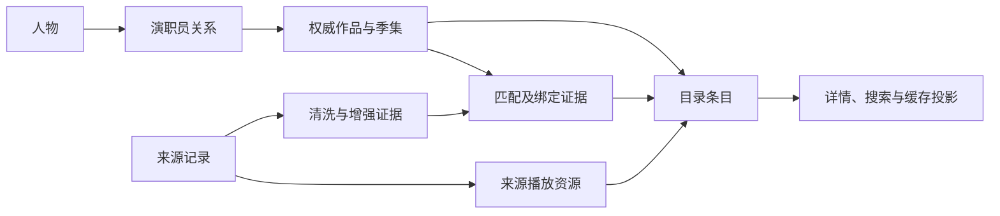

# V3 数据建模与实体关系审计

2026-11-23。本次审计以 V3 的应用读写路径、Liquibase 迁移和生产 PostgreSQL 只读快照为依据。核对范围包括目录、采集与聚合、资源、用户、任务、运营和基础设施数据。统计是 4.0.3 升级前的基线，持续采集会改变计数。

## 基线和工程判断

| 检查点 | 基线 | 判断 |
| --- | --- | --- |
| 关系库 | 59 张业务及运维表、3 个视图、238 个有效索引、46 个外键、52 个 CHECK 约束 | 保留一个 PostgreSQL 实例内的事务和外键。先按写入归属划分领域，按跨服务读取成本决定是否拆库。 |
| 权威目录 | 1,039 个权威作品、1,135 个权威目录条目、全站 1,308 个目录条目，另有 2,007 条来源记录 | 作品、季集和前台条目已有不同粒度。相同作品可以有多个季条目，前台 UUID 仍是收藏和访问的稳定锚点。 |
| 聚合绑定 | 548 条权威来源绑定均存在匹配证据，抽检 SQL 发现 0 个来源记录同时绑定多个条目 | 保留复合外键。修复所有公开读入口和管理写入口的证据规则，未来用确定的合并、拆分语义决定是否增加绑定唯一约束。 |
| 库空间 | 约 596 MiB，其中 TMDB 双快照表及索引约 526 MiB，约占 88% | 快照切换保持原子性。读路径使用 active slot 与类型索引，容量治理优先检查快照保留与索引写放大。 |
| 封面 | 338 组物理路径被 892 行封面记录共用，338 组均有至少一行被当前目录或来源记录引用 | 内容寻址确实发生了合并。按封面 ID 解链和存储对象生命周期需要各自管理。 |
| 数据源归属 | 4 个被来源封面或播放记录实际引用的域名对应多个数据源，样本最大为 2 个来源 | 域名是可共享的网络位置，数据源和域名采用多对多关系。 |
| 用户 | 会员、用户提交的求片记录均为 0 | 用户模型问题来自可复现的代码路径和约束检查。上线前仍需修复所有权、日限和续播一致性。 |

权威 TMDB 及 IMDb 展示 ID 与条目关系在基线无差异。1,135 个权威条目中，166 条缺描述、28 条缺演员展示值、365 条缺导演展示值。缺失应按提供方覆盖率、季级角色和元数据结果分别衡量。来源、目录的已填年份在基线均为四位文本，后续类型收敛以兼容迁移为主。

## 命名与目标关系

`catalog_works` 表示影视作品或可独立识别的节目，`catalog_entries` 表示面向产品发布、搜索、收藏的目录条目。现有 `unified_videos` 应迁往 `catalog_entries`，保留 UUID 和公开 API 标识。素材二进制对象使用 `media_assets`。 `assert` 是编程中的断言术语。

| 领域 | 当前模型 | 关系及命名决策 |
| --- | --- | --- |
| 目录事实 | `authority_catalog_works`、`authority_catalog_seasons`、`authority_catalog_episodes` | 作品 1:N 季、季 1:N 集。已验证 TMDB 种类和 ID、季号和集号使用类型化约束。权威优先和来源优先最终进入同一个作品模型，保留作品级置信来源。体育和短剧按事件身份或剧集作品身份建模，采集路径和可信度留在证据层。 |
| 发布目录 | `unified_videos`、`authority_catalog_projections`、`unified_video_tags` | 使用 `catalog_entries` 管理发布状态、可见性和公开 UUID，持久化作品或季的发布范围。详情、卡片和搜索文档从事实与发布规则生成。标签保留条目关系，展示字段可批量投影。 |
| 权威身份、评分与榜单 | `external_catalog_identities`、`external_catalog_events`、`external_trend_boards`、`external_trend_observations`、各表的 TMDB/IMDb 列 | 外部 ID 按 provider、实体类型、规范 ID 唯一，未知使用 NULL。评分保留提供方、评分、票数、观察时间。榜单观察以提供方、榜单、窗口、观察时间为键，关联目录并保留最近成功快照。档期事实、榜单观察和有可播放资源各有归属。 |
| 演员、导演与其他人员 | 现有名称数组与新增 `people`、`person_external_ids`、`catalog_credits` | 人物与作品多对多，关系承载职务、角色、排序、来源和作品／季／集范围。同一演员也可担任导演。标题与来源原文继续保留名称证据，前台数组作为低成本展示投影。 |
| 来源与域名 | `data_sources`、`source_domains`、`raw_videos`、新增 `data_source_domains` | 来源记录建议命名为 `source_records`，稳定键为数据源和上游条目 ID。每条来源记录可保留原文、清洗结果及输入版本。数据源 N:M 域名，同一域名可提供多个源的封面或播放地址。绕开代理、域名可达等运行状态放在独立观测层。 |
| 聚合与播放 | `raw_video_unified_video`、`authority_resource_bindings`、`playlists`、`episodes` | 当前绑定用 `catalog_source_bindings` 表达，证据带规则版本、来源和选定范围。上游的 `episodes` 命名为 `source_episodes`，上游的 `playlists` 命名为 `source_playlists`。规范季集能够关联多个播放资源。资源被记录、正确归属、可公开和最近实际可播分别建模。 |
| 磁链与解析 | `magnet_links`、`magnet_providers`、`magnet_provider_runs`、`magnet_search_jobs`、`video_resolver_sources` | 保留提供方、调度、执行结果和审核关系的职责分离。当前条目内 info hash 去重满足现有查询。全局按 info hash 管理资产应以跨条目实际共用和复核需求为依据，并由条目关联独立完成审核。 |
| 封面与存储 | `cover_images`、本地文件、R2 对象 | 封面元数据表示来源、格式与展示引用。物理对象按存储后端、桶和对象键唯一，内容哈希用于复用。把活动引用与物理对象回收条件建在同一库，应用事务删除业务关系，回收任务持有可重试的状态。 |
| 分类与标签 | `standard_category`、`standard_genre`、`standard_areas`、`standard_languages`、代码数组 | 标准字典保留。发布分类以一个受约束的 ID 或稳定 slug 为主键引用。需要过滤和统计的流派可用关系表，读投影继续使用数组。名称池与别名由来源和用途决定粒度，不为形式统一增加逐项查询。 |
| 求片、互动与积分 | `portal_media_requests`、`portal_media_request_batches`、`portal_media_request_batch_items`、`member_favorites`、`member_watch_histories`、`user_messages` | 求片全局需求与会员提交拆开，批次执行关联需求。收藏保留会员和目录的唯一关系。续播以目录与规范季集为主键语义，可附最后播放来源。积分使用幂等流水记录扣费原因，余额表服务热读和原子检查。用户消息按会话、作者和送达目标保留可追溯关系。 |
| 账号与配置 | `members`、`member_oauth_accounts`、`admin_api_tokens`、`sys_credentials`、`system_configs` | 个人资料和提供方登录身份保持分离，提供方主体唯一。运维凭据保留 provider 特有 JSON 载荷和租约所需的结构化字段。稳定 fingerprint 由库约束去重。可变配置保留命名空间，对影响限流与上线的值在使用方做类型和范围检查。 |
| 调度及证据 | `collection_tasks`、`catalog_discovery_requests`、`catalog_metadata_requests`、`authority_catalog_imports`、`raw_video_pipeline_runs`、`raw_video_enrichment_provider_runs`、`failed_messages` | 计划和运行应分离，运行持久化一次执行的参数版本、目标范围、租约和结果证据。重试接管使用进度版本或租约 token。分发队列承载执行；状态要能从数据库事实和记录恢复。 |
| 审计与运营 | `ops_alert_events`、`ops_incidents`、`ops_healing_actions`、`maintenance_operations`、`request_audit_logs`、`worker_job_audit_events`、`audit_archive_entries`、`notification_mail_send_history`、`ops_*_snapshots` | 告警、事件处置、修复动作和审计事实粒度不同，保持分离。报表和快照可从事实重建，保留刷新版本与时间。高频证据按已配置的保留策略归档并观察写入体量。 |

两条采集链路共享发布目录。作品、人员、来源身份、权益与运营事实留在 PostgreSQL。Elasticsearch、L1/L2 缓存、前台卡片和边缘页使用版本化读投影。Valkey 中的任务和租约有自己的恢复语义，部署与回收按任务数据生命周期管理。

## 关系缺口与修复次序

1. **P1，权威目录内容事实不完整。** 权威作品表有类型、外部 ID、标题和年份，描述、海报关联、部分展示数组仍直接写入 `unified_videos`。增量更新字段比首次创建少。先把事实及来源版本写到作品和季的持久模型，再让投影从同一组字段更新。验收覆盖改名、换海报、来源缺字段、手工锁定、同一作品多个季和重复更新。 [权威表迁移](../../platform/ircs-migrator/src/main/resources/db/changelog/2026/11/23-01-authority-first-catalog.sql) [目录元数据写回](../../services/ircs-metadata-worker/src/main/java/com/prodigalgal/ircs/metadata/catalog/CatalogMetadataRepository.java)
2. **P1，绑定证据与播放读取路径曾有缺口。** 既有复合外键保证每条权威证据有对应的当前绑定。旧管理写入缺少证据，旧读函数允许显式季标签或电影资源绕过证据要求。4.1.1 候选同时处理写入和读取。当前绑定排他性、人工审核员标识、证据历史、合并和拆分仍需一并设计。 [绑定迁移](../../platform/ircs-migrator/src/main/resources/db/changelog/2026/11/23-04-authority-binding-integrity.sql) [新播放约束](../../platform/ircs-migrator/src/main/resources/db/changelog/2026/11/23-07-authority-playback-binding-proof.sql)
3. **P1，求片聚合和用户归属混用。** 按标题和年份全局去重时，会增加需求计数并更新备注，但保留首位会员为唯一 owner。其他用户可能被扣积分却查不到自己的提交，已有用户的备注归属也可能变化。删除原 owner 可能级联移除全局需求和批次项。全局需求、会员提交、积分流水应在一笔本地事务更新，会员查询与每日限额按提交计数。历史快照保留完成状态和提交事实。 [求片读写](../../services/ircs-interaction-service/src/main/java/com/prodigalgal/ircs/interaction/JdbcMediaRequestRepository.java) [积分扣减](../../services/ircs-interaction-service/src/main/java/com/prodigalgal/ircs/interaction/MemberPointLedger.java)
4. **P1，续播关联缺少同一归属校验。** 独立外键能验证来源与来源集 ID 存在，仍可组合成与目录条目无关的记录。现有时间戳条件可以保护批量写入的幂等顺序。统一写入口应检查当前目录与来源绑定、来源集归属，并优先持久化规范单集 ID，换源后可继续恢复播放进度。 [续播读写](../../services/ircs-interaction-service/src/main/java/com/prodigalgal/ircs/interaction/JdbcInteractionRepository.java) [续播命令](../../services/ircs-interaction-service/src/main/java/com/prodigalgal/ircs/interaction/InteractionCommandService.java)
5. **P1，封面物理生命周期缺少独立所有权。** 旧清理先删物理对象，随后由外键决定是否删除封面记录。物理路径可被另一行复用，也可能因并发加引用而仍在使用。4.1.1 候选删除封面元数据时保留共享对象，R2 同步后保留可被其他记录复用的本地副本。待独立对象拥有引用与回收状态后，按有界批次处理新目录中的无引用物理对象。 [封面元数据清理](../../services/ircs-storage-service/src/main/java/com/prodigalgal/ircs/storage/image/CoverImageMetadataDeletionService.java)
6. **P2，季号 0 同时承担特辑和通配。** 权威事实存在 261 个已知的季 0 记录，基线无对应权威发布条目。补抓任务用 0 表示整部或任意季，部分写入口直接跳过 0。目标模型用 WORK、SEASON、EPISODE 明确范围，并用复合外键验证真实季集。现有队列协议需要有版本地迁移。 [补抓写入](../../services/ircs-metadata-worker/src/main/java/com/prodigalgal/ircs/metadata/catalog/AuthorityCatalogImportRepository.java) [目录补抓调度](../../services/ircs-content-service/src/main/java/com/prodigalgal/ircs/content/video/infrastructure/TrendCatalogRepository.java)
7. **P2，内容判定与导入任务失败原因耦合。** 现有保护会在提供方确认成人标记时隐藏发布条目，但导入表的 `last_error` 也用来保存持续阻断。持久的内容评估应明确记录主体、来源、规则或模型版本、结论与时间。暂不可用可作为单独的检查结果，条目继续按持久评估执行发布策略。 [权威导入状态机](../../services/ircs-metadata-worker/src/main/java/com/prodigalgal/ircs/metadata/catalog/AuthorityCatalogImportRepository.java)
8. **P2，来源版次影响重抓有效性。** 直连采集曾用不含独立播放列表的 hash 识别输入。只换资源地址、详情字段没变时可能被判未变更。4.1.1 候选把直连列表纳入输入 hash。域名按封面和播放观察回填，逐条封面和每次播放列表批量写入关系。计划表中的最新运行状态只适合快速展示，重放需要一次运行的计划、参数与批次证据。 [采集映射](../../services/ircs-scraper-service/src/main/java/com/prodigalgal/ircs/scraper/ScraperMappingService.java) [来源域名关系](../../platform/ircs-migrator/src/main/resources/db/changelog/2026/11/23-06-data-source-domain-membership.sql)
9. **P2，读投影对账范围有限。** 权威条目有 `index_pending`、generation 和条件确认，能从提交与入队之间的失败恢复。搜索普通入队走提交后回调，周期对账只找 PostgreSQL 中存在而搜索索引缺失的 ID。索引中已有旧版本或数据库删除后残留的文档，需要按版本和删除标记对账。采用有界游标与批量查询，保持 PostgreSQL 为事实源。 [提交后投递](../../shared/ircs-common/src/main/java/com/prodigalgal/ircs/common/search/SearchSyncWorkPublisher.java) [索引对账](../../services/ircs-search-service/src/main/java/com/prodigalgal/ircs/search/sync/SearchReconciliationRunner.java)
10. **P2，凭据去重依赖应用先查。** 目前写路径按 fingerprint 查询重复，初始迁移在 fingerprint 上提供普通索引。并发创建应使用数据库唯一约束，稳定去重键与额度归属同步确定。密钥载荷按提供方接口格式保存，审计查询只核对表结构、计数和引用。 [凭据写入](../../services/ircs-credential-service/src/main/java/com/prodigalgal/ircs/credential/CredentialService.java) [凭据初始迁移](../../platform/ircs-migrator/src/main/resources/db/changelog/2026/06/add-key-pool.sql)

## 本轮迁移与验收

- 4.1.1 候选追加三个 Liquibase 结构 changeset。新建人物、外部人物 ID、演职员角色和数据源域名关系。权威播放证据门同时覆盖详情、榜单库存和目标补抓，权威电影的已批准磁链仍走其独立审核路径。现有公开标识和路由沿用现有契约。
- 人物关系与权威事实同事务落库。电影使用片级 credits，电视剧全剧使用 TMDB aggregate credits、季使用季级 credits，单集客串和剧组来自已取得的季详情。人员按 provider ID 去重，同名仍可对应多个独立人物。不完整的角色组仅写可核验的新增证据。生产回填复用导入队列，已成功且已验证的公开范围每 5 秒逐个到期，普通导入优先，保留凭据限流和退避。 [人物迁移](../../platform/ircs-migrator/src/main/resources/db/changelog/2026/11/23-05-catalog-people-and-credits.sql) [TMDB 全剧演职员](https://developer.themoviedb.org/reference/tv-series-aggregate-credits) [合并详情子请求](https://developer.themoviedb.org/docs/append-to-response)
- 纯缺字段响应保留已有可核验证据。新增人员和关系写入采用批量 SQL，按人物关联反查有专用索引。首页继续读现有扁平投影。后续需要做人物作品列表时，先分页取条目或人物主键，再批量补出演关系。
- R2 旧封面删除另行完成。活动生产库对旧前缀的封面和头像引用均为 0。R2 在 `ircs/covers/` 确认删除 39,133 个对象，共 4,499,344,739 字节，重新列举为 0。当前 `catalog-v3-covers/` 代表对象删除前后均验证可读。数据库和其他对象前缀不属于此次清理范围。
- 应用验收由 GitHub Actions 对改动模块执行。生产发布以通过验证的不可变镜像为准，观察迁移 tag、权威绑定差异、人物和角色数量、回填队列消化、数据库写入和必要的公开路径。回滚使用上一组不可变镜像。播放证据 SQL 与门禁需一起复核，人物和域名关系表优先保留供重新启用时使用。
- 首个 4.1.0 候选在 Java 测试门禁发现一项入库断言对不上 SQL，存储代理测试仍调用已移除的逐对象删除入口。4.1.1 修正这两个测试，并用单批关系写入覆盖采集消息携带既有域名 ID 的情况。 [4.1.0 门禁结果](https://github.com/Prodigalgal/ircs-project-v3/actions/runs/45145794727)
- 4.1.1 已发布到生产空库，GitHub Actions 对七个模块执行 660 项 Java 用例，构建六个组件的双架构 Native 镜像。按停采要求初始化关系表后保持 0 条业务数据。旧目录清理、停采开关和上线验收见空库切换报告。 [4.1.1 发布门禁](https://github.com/Prodigalgal/ircs-project-v3/actions/runs/45146888167) [空库切换报告](../architecture/142-v3-empty-catalog-reset.md)
