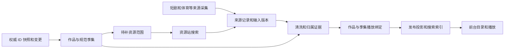

# 权威目录与资源站接入设计

2026-11-25 空库切换暂停了全量库存和旧采集调度。下一阶段按选片配额、可播条件和留存期限管理目录。 [按需求建立可播放目录](../architecture/curated-catalog.md)

## 采集入口与职责

电影、正规剧集和纪录片以权威作品为采集起点。权威导入生成作品、季、集与公开目录条目，资源发现任务只请求该作品缺少的播放范围。短剧、体育和其他缺少可靠权威身份的内容从资源站采集，清洗后建立临时作品身份。后续发现权威标识时，凭独立证据升级身份或进入待复核队列。

## 三方数据增量同步

| 来源 | 字段职责 | 直接采集入口 |
| --- | --- | --- |
| TMDB | 主目录的作品类型与身份、标题和原名、简介、封面、年份和首发信息、地区、语言、分类、演员与导演、规范季集及目录主评分。 | 每日 ID 快照、电影与电视变更接口、作品和季集详情。 |
| IMDb | 独立的 IMDb 评分及投票数。用已验证的 `tt…` 对齐，补充各地区片名和别名，并保留基础字段供校对。 | 流式读取 `datasets.imdbws.com` 的 `title.ratings.tsv.gz`、`title.basics.tsv.gz` 和 `title.akas.tsv.gz`。 |
| 豆瓣 | 已验证的条目 ID、中文标题和别名、明确标注的中国大陆上映或首播日期、独立的豆瓣评分及评分人数。原名和年份作为来源事实留存。 | 直接读取 `movie.douban.com` 公开条目页。缺少已验证的条目 ID 时，用公开标题检索定位候选。 |

IRCS 5.1.0 使用 `25-01-catalog-reference-sync.sql` 建立同步租约和检查点。通过 GitHub Actions 发布候选镜像，Argo CD 先完成数据库迁移，再更新相关应用。生产先验证 TMDB 库存、详情和搜索投影，按来源白名单逐步开放资源补抓。

TMDB 每日文件建立 ID 库存，详情按用户求片、热播、近期发行和历史队列分配预算。纪录片按作品类型、分类和发行信息建立电影或剧集结构。变更接口默认覆盖 24 小时，可查至 14 天。同一页变更完成后才推进 UTC 游标，处理中收到变更时保留下一次刷新，超过窗口时重新排队已跟踪作品。新变更 ID 必须出现在当前生效的公开库存，每页最多加入配置上限内的作品，默认 3 部。新增目录同步任务使用独立低优先级。剧集导入时按已验证的季清单递进补齐其他常规季，特别篇需要明确的季任务。 [TMDB 每日 ID 导出](https://developer.themoviedb.org/docs/daily-id-exports) · [TMDB 变更接口](https://developer.themoviedb.org/docs/tracking-content-changes)

IMDb 下载复用代理池，按各文件的 ETag 或 Last-Modified 做条件请求。源文件更新时流式下载并解压，原始压缩包和解压后的 TSV 均不写入磁盘。目录关联或输入地址变化后重新扫描。完整读完并写入后推进各文件检查点，分批写入可重放。 [IMDb 数据说明](https://data.imdb.com/non-commercial-datasets/)

IMDb 别名最多为每个已验证作品保留 32 项，优先原名和中文地区或语言的名称。每项带 IMDb 提供的地区、语言和原名标志。别名快照经完整性校验后独立比较，同一作品只有别名集合变化时才增加来源观察。源文件中已删除的别名以新集合记录，目录主标题仍由 TMDB 管理。

TMDB 主目录导入和外部来源补齐有各自的进度。导入读作品详情和外部 ID。已发布作品的 IMDb ID 仍空缺时，每 15 分钟按类型挑少量超过七天未核验的作品，复用 TMDB 详情队列补查。正在执行或等候重试的任务沿用自己的状态。

豆瓣按已验证目录作品滚动刷新，只有 TMDB ID 的作品也进入候选。优先按标题取最多三个候选，缺少外部 ID 命中且原名不同时再用原名取最多三个，按条目 ID 去重。已有 IMDb ID 时优先用详情页的相同 ID 确认。依赖 TMDB 详情时，标题或别名、年份、作品类型须一致，且至少有两位不同的主创吻合，其中至少一位是主演。双方都有导演资料时须有交集。未凭外部 ID 核对的剧集仅在单季范围及集数明确一致时自动关联。

确认的豆瓣条目可补齐缺失的 IMDb ID。写入前验证目录身份和 TMDB 详情版本，与已验证的权威 ID 冲突或多个豆瓣候选同时符合时进入冲突状态。未找到对应作品或主资料不全时，新的 TMDB 详情可提前触发复查。豆瓣复用既有代理出口，访问拒绝或限流时按来源延后检查。中国大陆日期取明确标注为中国大陆的最早有效上映或首播日期。

补充元数据写入 `catalog_metadata_observations`，相同事实只保存一次。评分及人数按作品、来源和观察日期写入 `catalog_rating_observations`。同分时票数变动也会记录，票数缺失时保留上一条同分样本。目录和搜索投影继续使用 TMDB 的主字段与主评分。

IMDb 和豆瓣的目录同步默认关闭，分别由 `APP_CATALOG_REFERENCE_IMDB_ENABLED` 和 `APP_CATALOG_REFERENCE_DOUBAN_ENABLED` 控制。IMDb 的基础、评分和别名快照地址可分别用 `APP_CATALOG_REFERENCE_IMDB_TITLE_BASICS_URL`、`APP_CATALOG_REFERENCE_IMDB_TITLE_RATINGS_URL` 和 `APP_CATALOG_REFERENCE_IMDB_TITLE_AKAS_URL` 配置。目录资源发现由独立的派单开关控制。

## 资源站发现与调度

1. 权威导入复用 `catalog_works`、`catalog_seasons`、`catalog_episodes` 和 `catalog_external_ids`。以提供方、类型和 ID 校验身份。未知权威 ID 保持空值。来源记录和每次输入版本分别保存在 `source_records` 与 `source_record_versions`。
2. 以现有 `catalog_resource_discovery_jobs` 记录缺资源的作品、季或集。电影按作品补抓。剧集先查整季，季已有资源后，每次权威刷新按播出日期从近 14 天的缺集中补充任务，每季未完成的集任务达到 3 条时暂缓新增。用户指定集仍以请求范围为准。季包按单集归属验收。单条已绑定线路只能完成它覆盖的范围。
3. 通过 `app.task.catalog-discovery.source-ids` 指定允许权威补抓的来源 UUID，以逗号分隔。定时采集计划继续控制轮询。未配置来源列表的部署沿用已启用计划的站点资格。配置列表后可保留原计划停用，由独立的 `app.task.catalog-discovery.enabled` 管理权威补抓。站点需要现有列表、详情、字段映射与非成人配置，查询失败按来源退避。
4. 优先使用资源站明确支持的权威 ID 或站内精确搜索。关键词查询按权威中文名、当地别名、原名的顺序尝试。年份与季集作为结果验收条件。概念相近的标题在类别、年份或季集冲突时保持独立。每次任务限制站点、页数、请求时间和并发，失败按证据区分无结果、网络失败、匹配冲突和未找到目标集。
5. 复用现有 `collection_runs`、队列租约、去重和代理池。提供方配额和单站限流覆盖所有代理出口，遇到限流按错误语义退避。只在明确没有权威候选且请求允许时，转入来源优先采集。暂时的权威接口故障保持可重试状态。

## 归属、播放与验证

`catalog_source_match_evidence` 关联输入版本、候选作品、季集和匹配证据。先匹配外部 ID 与作品形状，然后核对季集。缺少外部 ID 时至少使用标题集合、年份、类别与可用的主创或时长交叉确认。冲突证据留在候选记录供复核。确认归属后写 `catalog_playback_bindings`，播放可达状态单独记在 `playback_availability_checks`，目录信息可先展示，前台播放范围来自已验证的绑定。资源换版时按新输入重做匹配和可达检查，索引更新由目录投影变更记录驱动。

首批验收用固定的权威和资源站响应，覆盖同名不同年、跨季误标、整季包含缺集、别名命中、缺权威 ID、资源站限流和重复投递。验收分别记录任务进入数量、确认绑定比例、错绑数、季集覆盖率、来源请求量和从权威入库到前台可播放的耗时。生产保持停采，通过受控的少量目标和现有代理验证后，再按来源和类别启用调度。
