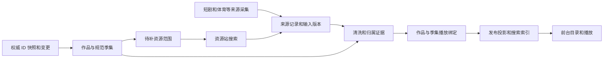

# 权威目录与资源站接入设计

## 采集入口与职责

电影、正规剧集和纪录片以权威作品为采集起点。权威导入生成作品、季、集与公开目录条目，资源发现任务只请求该作品缺少的播放范围。短剧、体育和其他缺少可靠权威身份的内容从资源站采集，清洗后建立临时作品身份。后续发现权威标识时，凭独立证据升级身份或进入待复核队列。

| 来源 | 5.0 已有入口 | 接入策略 |
| --- | --- | --- |
| TMDB | 每日 ID 快照、电影与电视变更游标、详情与季集导入 | ID 快照建立库存。详情按用户求片、热播、近期发行和历史队列分配预算，按变更游标补齐。纪录片根据 TMDB 的作品类型、分类和发行信息保留电影或剧集形状。 |
| IMDb | 读取 TMDB 提供的外部 ID，与作品身份对齐 | 保留 IMDb ID 的来源证据。引入有适用授权的数据源后，独立接入别名、评分和季集观察。IMDb 官方 TSV 每日提供个人或非商业用途的数据子集，按其许可范围使用。 |
| 豆瓣 | 已有标题检索、详情补齐与榜单来源 | 用中文译名、别名、年份和主创补齐。只有跨来源证据确认同一作品时，才把豆瓣 ID 写入已验证外部身份。 |

TMDB 的每日文件提供 ID 和少量筛选字段。完整详情按需获取。变更接口默认覆盖 24 小时，查询窗口可扩至 14 天。同步任务先提交本页变更再移动游标，恢复后从最近成功页继续。超过变更窗口时按 ID 快照补差集。[TMDB 每日 ID 导出](https://developer.themoviedb.org/docs/daily-id-exports) · [TMDB 变更接口](https://developer.themoviedb.org/docs/tracking-content-changes) · [IMDb 官方数据说明](https://data.imdb.com/non-commercial-datasets/)

## 资源站发现与调度

1. 权威导入复用 `catalog_works`、`catalog_seasons`、`catalog_episodes` 和 `catalog_external_ids`。以提供方、类型和 ID 校验身份。未知权威 ID 保持空值。来源记录和每次输入版本分别保存在 `source_records` 与 `source_record_versions`。
2. 以现有 `catalog_resource_discovery_jobs` 记录缺资源的作品、季或集。电影按作品补抓。剧集先查整季，季已有资源后，每次权威刷新按播出日期从近 14 天的缺集中补充任务，每季未完成的集任务达到 3 条时暂缓新增。用户指定集仍以请求范围为准。季包按单集归属验收。单条已绑定线路只能完成它覆盖的范围。
3. 通过 `app.task.catalog-discovery.source-ids` 指定允许权威补抓的来源 UUID，以逗号分隔。定时采集计划继续控制轮询。未配置来源列表的部署沿用已启用计划的站点资格。配置列表后可保留原计划停用，由独立的 `app.task.catalog-discovery.enabled` 管理权威补抓。站点需要现有列表、详情、字段映射与非成人配置，查询失败按来源退避。
4. 优先使用资源站明确支持的权威 ID 或站内精确搜索。关键词查询按权威中文名、当地别名、原名的顺序尝试。年份与季集作为结果验收条件。概念相近的标题在类别、年份或季集冲突时保持独立。每次任务限制站点、页数、请求时间和并发，失败按证据区分无结果、网络失败、匹配冲突和未找到目标集。
5. 复用现有 `collection_runs`、队列租约、去重和代理池。提供方配额和单站限流覆盖所有代理出口，遇到限流按错误语义退避。只在明确没有权威候选且请求允许时，转入来源优先采集。暂时的权威接口故障保持可重试状态。

## 归属、播放与验证

`catalog_source_match_evidence` 关联输入版本、候选作品、季集和匹配证据。先匹配外部 ID 与作品形状，然后核对季集。缺少外部 ID 时至少使用标题集合、年份、类别与可用的主创或时长交叉确认。冲突证据留在候选记录供复核。确认归属后写 `catalog_playback_bindings`，播放可达状态单独记在 `playback_availability_checks`，目录信息可先展示，前台播放范围来自已验证的绑定。资源换版时按新输入重做匹配和可达检查，索引更新由目录投影变更记录驱动。

首批验收用固定的权威和资源站响应，覆盖同名不同年、跨季误标、整季包含缺集、别名命中、缺权威 ID、资源站限流和重复投递。验收分别记录任务进入数量、确认绑定比例、错绑数、季集覆盖率、来源请求量和从权威入库到前台可播放的耗时。生产保持停采，通过受控的少量目标和现有代理验证后，再按来源和类别启用调度。
